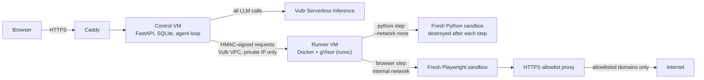

# Blast Radius Zero Agent

> A web agent that does real work, writing and running code or operating a real browser, with **every action contained in a gVisor sandbox on Vultr**. It plans, dispatches, and returns **hashed, verifiable output**.

Built for the **Vultr: Agent Rush Hackathon**, Challenge 1 "Blast Radius Zero". License: MIT.

## What it does
Give it a task in a chat UI. The agent loop runs on a Vultr VM:

1. **Plan:** the LLM (Vultr Serverless Inference) breaks the task into steps.
2. **Dispatch:** each step (Python code, or a list of browser actions) is sent to an isolated runner.
3. **Execute:** the runner starts a fresh gVisor container, runs the step, returns real stdout/stderr, exit code, files and screenshots, then destroys the container.
4. **Retry:** errors go back to the LLM, which fixes the code (up to 3 failures).
5. **Verify:** each step shows SHA-256 of code and output. The final answer is checked: every number in it must appear in executed output, otherwise it is flagged "Not fully verified".

Pattern A (sandboxed code execution) and Pattern B (sandboxed browser use with Playwright and screenshots) are both implemented.
Example tasks: CSV analysis and charts, self-healing code runs, "open a page, read a heading, count words", site checks.



## Vultr services used
| Service | Role |
|---|---|
| **Vultr Cloud Compute** | Control VM (web app, orchestration, history) and Runner VM (sandbox host). Vultr is the control layer. |
| **Vultr Serverless Inference** | Every planner and agent LLM call (`https://api.vultrinference.com/v1/chat/completions`) |
| **Vultr VPC 2.0** | Private network between control and runner; the runner has no public service port |
| **Vultr Firewall + UFW** | Runner accepts port 8001 only from the control VM private IP |

## Containment
| Focus | What we do |
|---|---|
| **Process isolation** | gVisor user-space kernel, read-only rootfs, tmpfs work dir, non-root user, all capabilities dropped, no-new-privileges. Browser container has no route to the internet except an allowlist proxy. |
| **Secret hygiene** | API keys exist only on the control VM. The sandbox environment has no secrets (checked live by an attack test). |
| **Resource limits** | 256 MB RAM (1 GB browser), 0.5 CPU, 64 pids, 30 s timeout (60 s browser), file size and output caps |
| **Lifecycle** | Fresh container per step, destroyed after (`--rm`), timeouts hard-kill the container |

Extra hardening: HMAC-signed control-to-runner requests with timestamp and replay cache; browser proxy is HTTPS-only, allowlisted, blocks private and metadata IPs and connects by resolved IP (no DNS rebinding); control and runner both re-check URLs; sandbox output is untrusted (re-validated, PNG magic check, artifacts served with `sandbox` CSP); web content is wrapped as untrusted data against prompt injection; strict CSP with no inline scripts, HttpOnly SameSite=Strict cookies, CSRF header, rate limits, one run at a time per visitor.

**Containment moment:** tap **Secure → Run attack tests**. Eight real attacks run in the sandbox and are shown blocked: network access, file write, `rm -rf`, fork bomb, memory bomb, infinite loop, root user, secret leakage.

## Deploy on Vultr (about 20 min)
1. Create a VPC 2.0 (`agent-vpc`) and two Ubuntu 24.04 VMs in it: control (2 vCPU / 4 GB) and runner (4 vCPU / 8 GB), Backups off.
2. Vultr Firewall: control allows 22 (your IP), 80, 443. Runner allows 22 (your IP) and TCP 8001 from the control private IP only.
3. Generate one secret and use it on both VMs: `export S=$(openssl rand -hex 32)`
4. Vultr Console → Serverless → Inference: create a subscription and copy the API key. The control script lists available model IDs; set `MODEL=<id>` if the default is missing.
5. Runner VM: `git clone <this repo> && cd <repo> && sudo PRIVATE_IP=<runner-private-ip> CONTROL_PRIVATE_IP=<control-private-ip> RUNNER_SECRET=$S ./deploy/setup_runner.sh`
6. Control VM: `sudo RUNNER_PRIVATE_IP=<runner-private-ip> RUNNER_SECRET=$S VULTR_INFERENCE_API_KEY=<key> ACCESS_CODE=<optional> ./deploy/setup_control.sh`
7. Open the printed `https://<ip>.nip.io` URL.

## Run locally (Docker Desktop, no gVisor)
gVisor is Linux-only, so locally use plain Docker with `SANDBOX_RUNTIME=runc`.
```
docker build -t sbx-python:1 -f runner/Dockerfile.python runner/
cd runner && pip install -r requirements.txt
SANDBOX_RUNTIME=runc RUNNER_SECRET=dev uvicorn runner:app --port 8001      # terminal 1
cd control && pip install -r requirements.txt
RUNNER_URL=http://127.0.0.1:8001 RUNNER_SECRET=dev SESSION_SECRET=dev COOKIE_SECURE=0 DATA_DIR=./data \
LLM_PROVIDER=vultr VULTR_INFERENCE_API_KEY=<key> uvicorn app:app --port 8000   # terminal 2
```
Open http://localhost:8000. PowerShell: use `$env:NAME="value"`. Browser mode also needs the `sbx-browser` and `sbx-proxy` images and `docker network create --internal sbx-internal`.

## Repo layout
```
control/   FastAPI app, agent loop, history (SQLite), web UI (static/)
runner/    sandbox runner, in-container harnesses, egress proxy, Dockerfiles
deploy/    setup scripts and systemd units for both VMs
docs/      submission text
```

## Limitations
Artifacts are stored on the control VM disk. Browser mode only visits allowlisted HTTPS domains (`BROWSER_ALLOWLIST`). Vision-model screenshot verification and human approval before final actions are not implemented yet.
